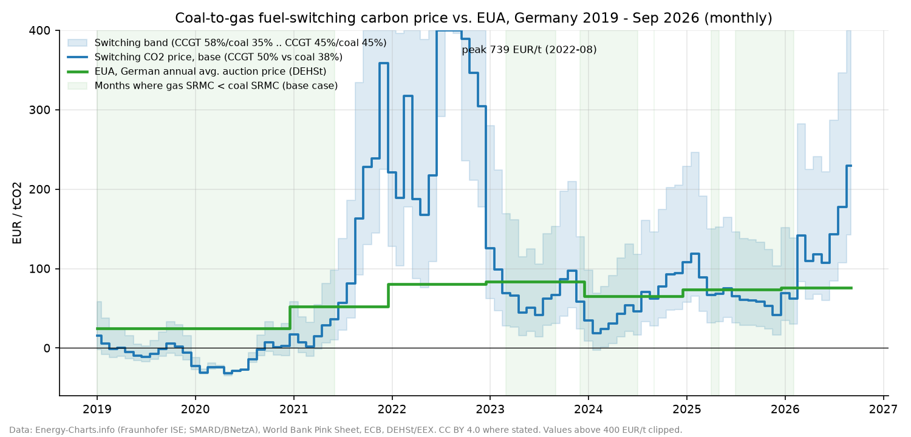
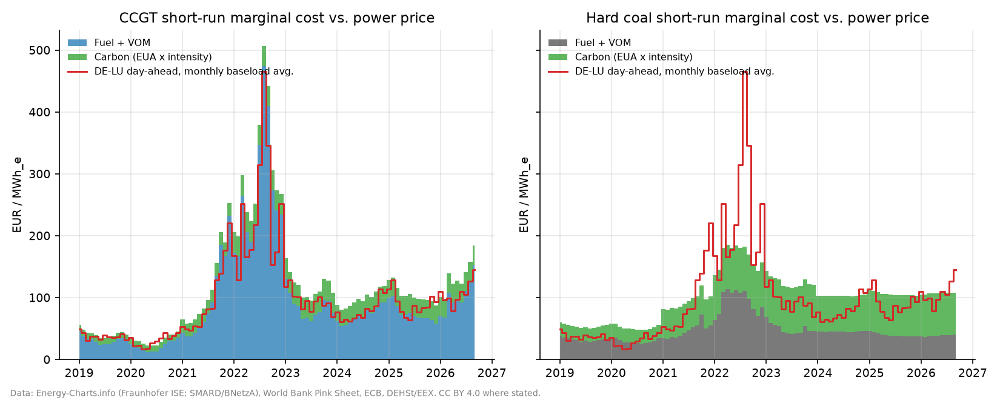
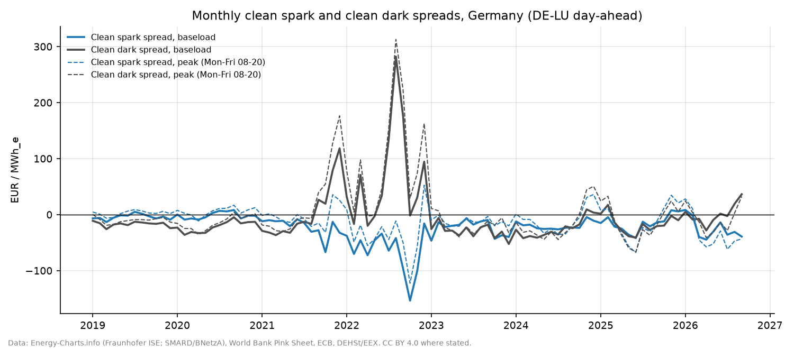
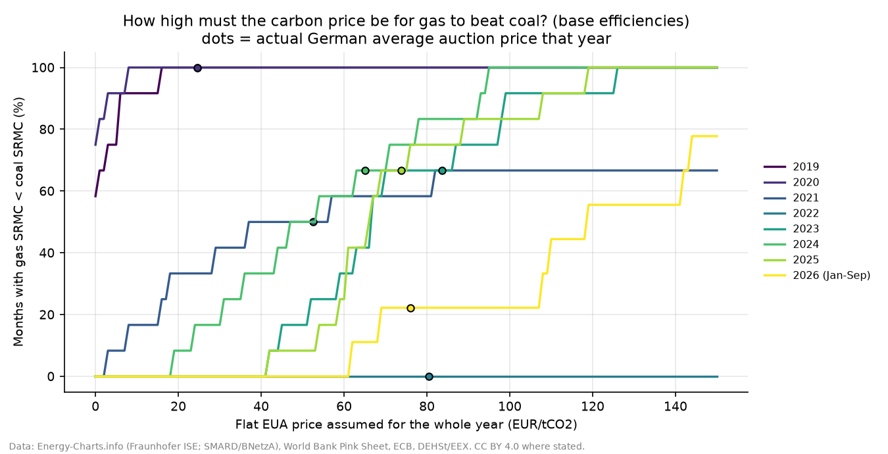
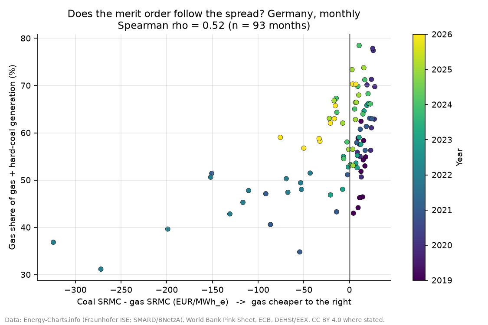
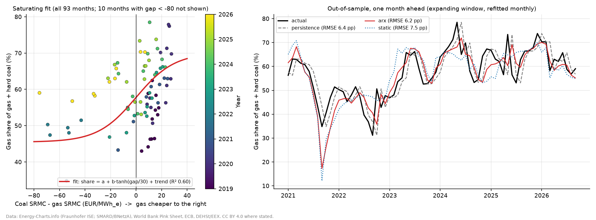
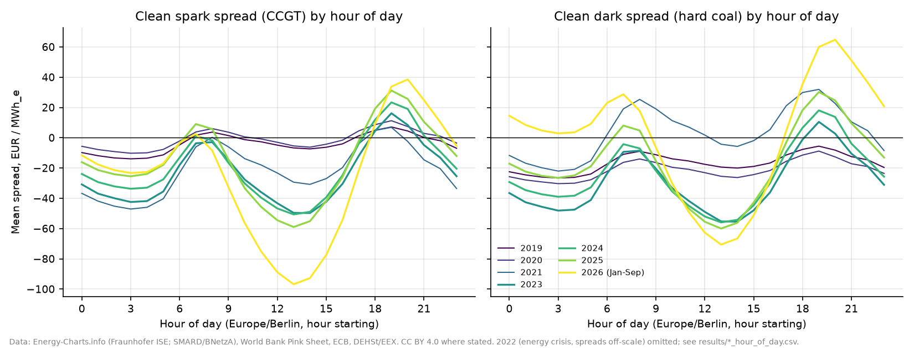
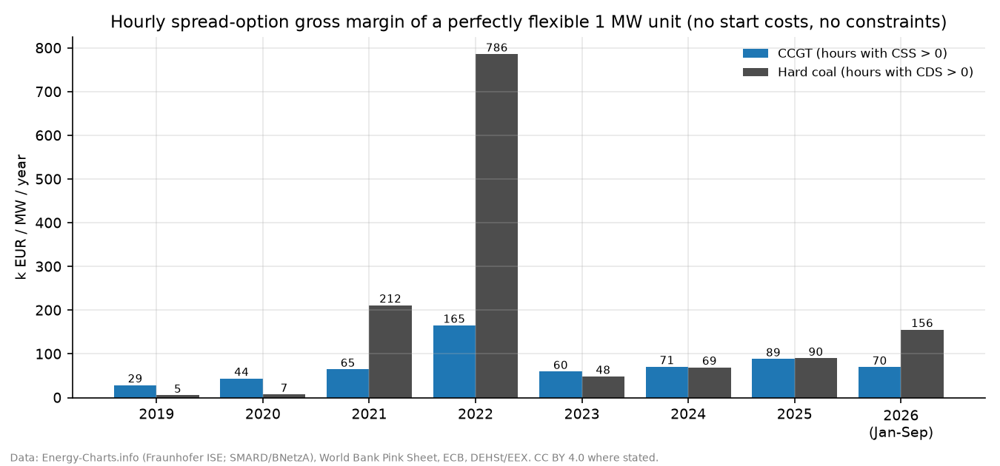

# Clean Spark & Clean Dark Spreads and the Coal-to-Gas Fuel-Switching Carbon Price (Germany, 2019 – Sep 2026)

When is a gas plant cheaper to run than a coal plant, and how high does the EU carbon price have to be to make it so?
This repo answers that for **Germany (DE-LU bidding zone)** with **real public data**. It covers 67,919 hourly day-ahead
prices, monthly TTF gas and thermal-coal prices, ECB exchange rates, official German EUA auction averages and actual
gas / hard-coal generation. From these it computes:

* monthly **short-run marginal costs (SRMC)** for a CCGT and a hard-coal unit (fuel + VOM + carbon),
* hourly **clean spark spreads (CSS)** and **clean dark spreads (CDS)**,
* the monthly **fuel-switching CO2 price**, the EUA level at which gas and coal SRMC are equal, together with an efficiency band,
* an **EUA sweep** that shows how high a carbon price would have been needed each year for gas to beat coal,
* a **reality check** that tests whether the actual German merit order (gas share of gas + hard-coal output) follows the modelled SRMC gap,
* a **statistical model of the gas share vs. the spread** (saturating regression with HAC errors) and an honest
  **out-of-sample forecast test** against naive baselines,
* the **hour-of-day shape** of spreads (solar cannibalisation) and a simple hourly **spread-option gross margin**.

> Plant parameters (efficiencies, VOM, coal freight) are **illustrative fleet assumptions**, not data for a specific unit.
> Everything else comes from the cited public sources. This is an analysis/teaching project. It is not a trading signal
> and it makes no claim about real-world trading performance.

---

## Key results (from `python run_all.py`)

Base case: CCGT 50 % efficiency (0.404 tCO2/MWh_e), hard coal 38 % (0.896 tCO2/MWh_e).

| Year | DE-LU baseload €/MWh | TTF gas €/MWh_th | Coal €/MWh_th (delivered) | EUA €/t (DE auction avg.) | Mean switching price €/t | Months gas < coal | Mean CSS €/MWh | Mean CDS €/MWh | Hours CSS > 0 | Hours CDS > 0 | Flex GM gas k€/MW | Flex GM coal k€/MW |
|---|---|---|---|---|---|---|---|---|---|---|---|---|
| 2019 | 37.7 | 14.6 | 10.7 | 24.66 | -1.0 | 12/12 | -4.0 | -16.7 | 39 % | 8 % | 29 | 5 |
| 2020 | 30.5 | 9.6 | 9.8 | 24.59 | -16.2 | 12/12 | -1.2 | -21.2 | 48 % | 8 % | 44 | 7 |
| 2021 | 96.8 | 47.1 | 16.0 | 52.47 | 102.7 | 6/12 | -21.6 | 3.5 | 26 % | 33 % | 65 | 212 |
| 2022 | 235.4 | 132.1 | 34.4 | 80.40 | 349.6 | 0/12 | -64.5 | 68.7 | 26 % | 66 % | 165 | 786 |
| 2023 | 95.2 | 41.4 | 17.4 | 83.68 | 72.3 | 8/12 | -23.9 | -29.5 | 28 % | 22 % | 60 | 48 |
| 2024 | 78.5 | 34.6 | 15.6 | 65.01 | 54.1 | 8/12 | -19.5 | -24.8 | 26 % | 23 % | 71 | 69 |
| 2025 | 89.3 | 36.4 | 13.6 | 73.86 | 72.1 | 8/12 | -15.7 | -16.7 | 36 % | 33 % | 89 | 90 |
| 2026 (Jan–Sep) | 107.7 | 49.8 | 13.2 | 76.02* | 128.7 | 2/9 | -25.3 | 0.9 | 36 % | 55 % | 70 | 156 |

\*H1-2026 DEHSt average, carried forward into Q3 2026. "Flex GM" is the sum of positive hourly clean spreads for a perfectly
flexible 1 MW unit (no start costs, ramping or outages), so it is an upper bound and not a plant P&L.

**What the data says**

* **Gas beat coal in 56 of 93 months.** At base efficiencies the switching price ranged from **−31.7 €/t (May 2020)**,
  when gas was cheaper than coal even before carbon, to **738.8 €/t (Aug 2022)** at the height of the gas crisis, when no
  plausible EUA could restore gas ahead of coal (0/12 months in 2022).
* **2023–2025 sat right at the switching point.** The average switching price (54–72 €/t) was close to the EUA (65–84 €/t),
  so the gas/coal ranking flipped month to month, and gas was cheaper in 8 of 12 months each year.
  In 2024 an EUA of only **47 €/t** would have been enough for gas to win half the months. In 2023 and 2025 it would have taken ~66–67 €/t.
* **2026 has swung back to coal.** World Bank TTF prices jumped from about 32–34 €/MWh_th (Jan–Feb) to 45–54 €/MWh_th (Mar–Jul), 62 in Aug and 75 €/MWh_th in Sep, which pushed the switching price
  to **229.7 €/t in Sep 2026**, about 3× the EUA. Gas was cheaper only in Jan–Feb. Getting gas ahead of coal in half of the 2026 months would
  have needed an EUA of about **119 €/t**.
* **The real merit order follows the spread.** Across 93 months, the gas share of gas + hard-coal generation
  (Energy-Charts actual output) has a Spearman ρ of **0.52** with the modelled coal-minus-gas SRMC gap. After removing each year's mean,
  which controls for slow structural change such as coal-plant closures, ρ rises to **0.64**. The gas share averaged **61.1 %** in months where gas was cheaper
  and **52.1 %** where coal was cheaper.
* **The spread explains the gas share, but does not help forecast it beyond last month's value.** A saturating fit
  `share = a + b·tanh(gap / 30 €/MWh) + controls` gives b = **11.0 pp** (Newey-West s.e. 1.8, t = 6.2) even with
  month-of-year and year fixed effects (R² 0.73), i.e. about **0.37 pp of gas share per €/MWh** near the switching point
  and **≈13 pp** between a month where coal is 20 €/MWh cheaper and one where gas is 20 €/MWh cheaper. Out of sample
  (one month ahead, Jan 2021 – Sep 2026, refitted each month on past data only), adding the gap to last month's share
  does not beat an AR(1) on the share alone (RMSE **6.22 vs 6.22 pp**); both are only **2.5 %** better than plain
  persistence (6.38 pp), and gap-only models are worse (7.46 pp). So the spread is a real driver, but month to month
  the share is mostly persistent and the rest is driven by things this data does not contain (CHP heat demand,
  outages, wind/solar, imports, closures).
* **Solar is reshaping the spreads.** In 2026 the average midday (13:00) clean spark spread is about **−97 €/MWh**, while the evening
  peak (20:00) is about **+38 €/MWh**. Thermal value now sits in the evening ramp, which is also where BESS competes.

### Figures

**Fuel-switching CO2 price vs. EUA**. Green shading marks months where gas SRMC < coal SRMC:


**SRMC build-up (fuel + VOM, carbon) vs. monthly baseload power price**


**Monthly clean spark & clean dark spreads (baseload and peak)**


**EUA needed for gas to beat coal, by year** (dots mark the actual German auction average)


**Reality check: actual gas share vs. modelled SRMC gap**


**Statistical model of the gas share and out-of-sample forecast check**


**Spreads by hour of day** (solar cannibalisation of midday hours)


**Upper-bound hourly spread-option gross margin**


---

## Method

Per MWh of electricity (MWh_e), for technology *x* ∈ {gas, coal}, with fuel price *p* (€/MWh_th), net efficiency η,
fuel emission factor EF (tCO2/MWh_th) and variable O&M:

```
fuel cost          F_x  = p_x / η_x + VOM_x                       [€/MWh_e]
carbon intensity   c_x  = EF_x / η_x                              [tCO2/MWh_e]
SRMC               S_x  = F_x + EUA · c_x
clean spark spread CSS  = P_DA − S_gas          clean dark spread  CDS = P_DA − S_coal
switching price    EUA* = (F_gas − F_coal) / (c_coal − c_gas)      gas is cheaper ⇔ EUA > EUA*
```

* **Fuel conversion.** TTF $/MMBtu × 3.412142 MMBtu/MWh ÷ (USD per EUR). Coal: (FOB Richards Bay $/t + 12 $/t freight to ARA/plant)
  ÷ (USD per EUR) ÷ 6.978 MWh_th/t (6,000 kcal/kg NAR).
* **Timing.** Hourly DE-LU day-ahead prices (15-min products from Oct 2025 are averaged to hours, Europe/Berlin time) are
  combined with that month's fuel prices and that year's EUA average.
* **Switching band.** The easiest switch is an efficient CCGT (58 %) vs. an old coal unit (35 %). The hardest is an old CCGT (45 %) vs. an efficient coal unit (45 %).
* **EUA sweep.** For each year, the share of months with S_gas < S_coal is computed for a flat EUA from 0 to 150 €/t.
* **Reality check.** Monthly mean gas and hard-coal net generation (Energy-Charts public net generation) is used to form the gas share of gas + hard coal,
  which is then rank-correlated with S_coal − S_gas. Lignite is excluded because it has no traded fuel price; its SRMC is
  mine-mouth and largely carbon-driven.
* **Gas-share model** (`src/spreads/regression.py`). Gas share (pp) is regressed on `tanh(gap / s)`, where gap = coal SRMC − gas SRMC,
  because switching saturates (the 2022 gap reached −324 €/MWh). Four specifications: + linear trend; + month-of-year + trend;
  + month-of-year + year fixed effects (explanatory only); + last month's share + trend (ARX). Standard errors are
  Newey-West (3 lags). The scale s is picked from {10, 20, 30, 50, 100} €/MWh by in-sample fit (30 in the full sample).
  **Forecast test:** expanding window starting Jan 2021 (24 training months), refitted every month on past data only, with s
  re-selected inside each training window; the gap of the predicted month is treated as known (a nowcast given that month's
  fuel and carbon prices). Baselines: persistence (last month), AR(1), same-calendar-month mean. A leave-one-year-out
  check of the trend model is also written (`results/gas_share_leave_one_year_out.csv`; RMSE 4.2–11.1 pp by year, worst 2020).

## Assumptions

| Parameter | Value | Source |
|---|---|---|
| CCGT efficiency (base / band) | 50 % / 45–58 % | ILLUSTRATIVE fleet values |
| Hard-coal efficiency (base / band) | 38 % / 35–45 % | ILLUSTRATIVE fleet values |
| Gas emission factor | 56.1 kgCO2/GJ = 0.20196 tCO2/MWh_th | IPCC 2006 Guidelines, Vol. 2, Table 2.2 |
| Coal emission factor | 94.6 kgCO2/GJ = 0.34056 tCO2/MWh_th (other bituminous coal) | IPCC 2006 Guidelines, Vol. 2, Table 2.2 |
| Coal calorific value | 6,000 kcal/kg NAR | World Bank Pink Sheet series definition |
| Coal freight + handling to plant | 12 $/t | ILLUSTRATIVE |
| VOM gas / coal | 2.5 / 4.0 €/MWh_e | ILLUSTRATIVE |
| Gas hub-to-plant cost | 0 €/MWh_th (TTF = delivered) | ILLUSTRATIVE |
| EUA | annual German average auction price (table above) | DEHSt / EEX |

All values are in [`config/assumptions.yaml`](config/assumptions.yaml). Edit it and re-run to test your own fleet.

---

## Data sources & licences

| Data | Source | Licence / terms |
|---|---|---|
| DE-LU hourly/15-min day-ahead price | [Energy-Charts API](https://api.energy-charts.info/) (Fraunhofer ISE), `/price?bzn=DE-LU`; original data Bundesnetzagentur / SMARD.de | **CC BY 4.0** (as stated in the API response) |
| Germany public net generation by fuel (gas, hard coal, lignite) | [Energy-Charts API](https://api.energy-charts.info/), `/public_power?country=de` | **CC BY 4.0** (Energy-Charts API data licence: "Unless stated otherwise … CC BY 4.0", attribution Energy-Charts.info) |
| Monthly Natural gas, Europe (TTF) and Coal, South African (FOB Richards Bay, 6,000 kcal/kg NAR), USD | World Bank, [Commodity Price Data (The Pink Sheet)](https://www.worldbank.org/en/research/commodity-markets), monthly historical file, release of 2 Oct 2026 | World Bank [Terms of Use for Datasets](https://www.worldbank.org/en/about/legal/terms-of-use-for-datasets) (attribution). The World Bank notes that some South African coal months in 2022–2024 are estimates. |
| Monthly USD per EUR reference rate | [ECB Data Portal](https://data.ecb.europa.eu/), series `EXR.M.USD.EUR.SP00.A` | ECB statistics reuse policy (free reuse with source acknowledged) |
| Annual average EUA auction price, Germany, 2019–2025 | DEHSt (German Emissions Trading Authority at UBA), ["Versteigerungsergebnisse seit 2012"](https://www.dehst.de/DE/Themen/EU-ETS-1/EU-ETS-1-Informationen/Versteigerung/versteigerung_node.html), source EEX/DEHSt | Individual figures cited as reference values |
| H1 2026 EUA average (Q1 75.95, Q2 76.12, H1 76.02 €/t) | DEHSt, *German Auctioning of Emission Allowances*, quarterly reports Q1 and Q2 2026 | Individual figures cited as reference values |
| CO2 emission factors | IPCC (2006), *2006 IPCC Guidelines for National Greenhouse Gas Inventories*, Vol. 2, Ch. 2, Table 2.2 | Cited values |

**No raw data is redistributed.** `run_all.py` downloads the source files into `data/raw/`, which is git-ignored.
`results/` contains only derived, aggregated outputs. Figures and derived tables carry the attribution above.

---

## How to run

```bash
python -m venv .venv && source .venv/bin/activate   # Windows: .venv\Scripts\activate
pip install -r requirements.txt
python run_all.py              # first run downloads ~45 MB into data/raw/ (cached), then ~5 s
python run_all.py --refresh    # force re-download
pytest -q                      # 11 unit tests
```

Outputs: `results/summary.json` (headline numbers), `results/annual_summary.csv`, `results/monthly_srmc_switching.csv`,
`results/monthly_generation_vs_spread.csv`, `results/css_hour_of_day.csv`, `results/cds_hour_of_day.csv`,
`results/gas_share_regression.csv`, `results/gas_share_forecast_oos.csv`, `results/gas_share_forecast_scores.csv`,
`results/gas_share_leave_one_year_out.csv`, `results/run_log.txt`, and the eight figures in `figures/`.

## Repository layout

```
config/assumptions.yaml   # plant parameters, emission factors, EUA reference prices (all tagged by source)
src/spreads/
  data.py                 # download + cache: Energy-Charts, World Bank Pink Sheet, ECB FX
  model.py                # SRMC, clean spreads, switching price, EUA sweep, generation check
  regression.py           # gas share vs SRMC gap: HAC regression, expanding-window forecast test
  plots.py                # figures
run_all.py                # end-to-end pipeline
tests/test_model.py       # unit tests (unit conversions, SRMC equality at EUA*, band ordering, sweep)
```

## Limitations

* **Monthly fuel prices and an annual EUA average** stand in for the daily forward/spot prices that plants actually hedge against.
  Intra-month moves, hedging and contract structures are ignored, and Q3 2026 carries forward the H1-2026 EUA.
  A monthly EUA series would be better, but no free, openly licensed one was found when checked (Oct 2026): Ember's
  carbon-price charts use Montel data that is not downloadable, ICAP's downloadable weekly series is ICE data under
  ICAP's terms of use, and EEX end-of-day files are a paid product. DEHSt's own auction reports remain a possible future source.
* **The gas-share model is a correlational time-series fit on 93 monthly points.** The tanh scale was chosen by fit, the
  crisis year 2022 has high leverage, and the regressors leave out heat demand, renewables, outages and imports, so the
  coefficients describe association, not a causal switching elasticity.
* **Generic plants.** Real fleets have a distribution of efficiencies, part-load penalties, start-up costs, minimum stable
  generation, must-run CHP heat obligations, gas transport/storage costs and coal logistics. The switching band shows only part of this spread.
* **South African FOB coal + fixed freight** is a proxy for the API2 (CIF ARA) price that German plants reference. Freight
  actually varies over time.
* **Gross margin is an upper bound.** It assumes perfect foresight, no start costs and full availability, and it ignores
  intraday/balancing markets and capacity payments.
* **The generation check is correlational.** Gas share is also driven by CHP heat demand, outages, coal phase-out
  (reserve and closures), grid constraints and imports. The within-year ρ partly controls for structural trends but is not causal.
* Lignite is excluded from the switching analysis.
* Educational/portfolio model. It is not validated against any specific asset and is not investment or trading advice.

## License

Code: MIT © 2026 Syed Muhammad Taha Nasir. See [LICENSE](LICENSE). Third-party data stays under the terms listed above.
